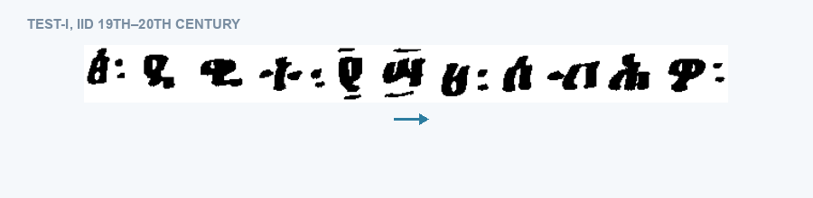
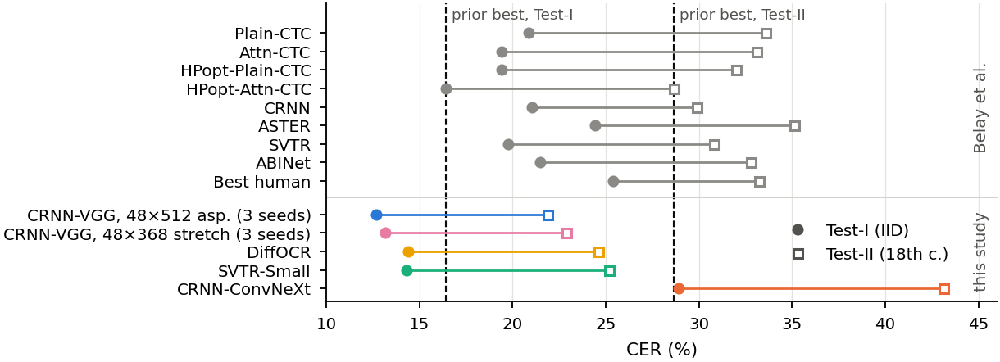
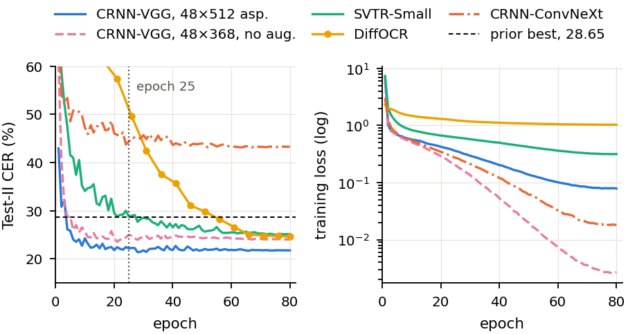

# HHD-Ethiopic Recognizers

Line-level optical character recognition for historical handwritten Ethiopic (Ge'ez script),
trained and evaluated on the HHD-Ethiopic benchmark of Belay et al. (ICDAR 2024).
Convolutional-recurrent, transformer and discrete-diffusion recognizers were trained under one
pipeline on the official splits. The best configuration, a CRNN with a VGG encoder and an
aspect-preserving 48×512 input, reaches a character error rate (CER) of 12.68 on the
in-distribution Test-I split and 21.88 on the 18th-century out-of-distribution Test-II split
(mean of three seeds), against 16.41 and 28.65 for the best published model.



*The best model (CRNN-VGG, aspect-preserving input, seed 2) transcribing two Test-I lines and two
Test-II lines on a CPU. Green text matches the ground truth exactly; dark text contains errors.
The per-line predictions for every test line are in `results/`.*

## Results

Character error rate (CER) and normalised edit distance (NED) in per cent, lower being better.
The published rows come from Table 3 of Belay et al. (2024), except the average human, which is
reported in their text. The rows of this work use the best-validation checkpoint of each run, and
± gives the standard deviation over three seeds (over two identically configured runs for the row
without augmentation).

| Method | Params (M) | Test-I CER | Test-I NED | Test-II CER | Test-II NED |
|---|---:|---:|---:|---:|---:|
| Plain-CTC (Belay et al.) | 2.5 | 20.88 | 19.09 | 33.56 | 31.90 |
| Attn-CTC (Belay et al.) | 1.9 | 19.42 | 21.01 | 33.07 | 32.92 |
| HPopt-Plain-CTC (Belay et al.) | 4.5 | 19.42 | 17.77 | 32.01 | 29.02 |
| HPopt-Attn-CTC (Belay et al., previous best) | 2.2 | 16.41 | 16.06 | 28.65 | 27.37 |
| CRNN (Belay et al.) | 8.3 | 21.04 | 21.01 | 29.86 | 29.29 |
| ASTER (Belay et al.) | 27.0 | 24.43 | 20.88 | 35.13 | 30.75 |
| SVTR (Belay et al.) | 6.0 | 19.78 | 17.98 | 30.82 | 28.00 |
| ABINet (Belay et al.) | 23.0 | 21.49 | 18.11 | 32.76 | 28.84 |
| Best human (Belay et al.) | | 25.39 | 23.78 | 33.20 | 30.77 |
| Average human (Belay et al.) | | 30.46 | 26.32 | 35.63 | 38.59 |
| **CRNN-VGG, 48×512 aspect-preserving, medium augmentation** | 8.86 | **12.68 ± 0.05** | **12.74** | **21.88 ± 0.15** | **21.76** |
| CRNN-VGG, 48×368 stretch, light augmentation | 8.86 | 13.15 ± 0.05 | 13.48 | 22.87 ± 0.16 | 22.76 |
| CRNN-VGG, 48×368 stretch, heavy augmentation | 8.86 | 13.07 | 13.50 | 22.46 | 22.43 |
| CRNN-VGG, 48×368 stretch, no augmentation | 8.86 | 13.76 ± 0.12 | 13.92 | 24.10 ± 0.12 | 23.81 |
| SVTR-Small, 48×512 aspect-preserving | 3.91 | 14.30 | 15.00 | 25.18 | 25.56 |
| DiffOCR (mask-based discrete diffusion), 48×512 | 10.00 | 14.39 | 14.43 | 24.61 | 24.12 |
| CRNN-ConvNeXt (ImageNet-pretrained), 48×512 | 31.52 | 28.91 | 22.97 | 43.11 | 37.66 |

CER is computed over the whole corpus (total edit distance over total ground-truth characters),
as in Eq. 3 of Belay et al.; applying the procedure of their released test notebook to our
predictions reproduces every CER above to within 0.001. The per-run numbers, including WER and
line accuracy, are in `tables/main_results.csv` and `results/<run>/metrics.json`. The PARSeq-Small
run in those files stopped after 5 of its 80 epochs, so its numbers are not a converged result,
and a TrOCR fine-tune could not be run because of a library incompatibility.



## What the experiments show

The gain over HPopt-Attn-CTC does not come from a longer schedule. HPopt-Attn-CTC was trained for
100 epochs, and continuing our convolutional-recurrent runs from 25 to 80 epochs changed their
Test-II CER by only -0.23 points on average. Of the 6.77-point Test-II gain, 3.96 points are
already present in the least-modified configuration (48×368 stretch, no augmentation, 25 epochs),
0.59 come from training it to 80 epochs, 1.23 from light augmentation and 0.99 from the
aspect-preserving canvas together with medium augmentation, at least 0.58 of which is geometry.

The ImageNet-pretrained ConvNeXt encoder fails because its stride-32 output leaves 16 CTC time
steps for a 48×512 line, so no line longer than 16 characters can be transcribed. Its errors are
mostly deletions (64% on Test-II), and the 25.4% of training lines that need more than 16 frames
receive a loss and a gradient of exactly zero under `zero_infinity=True`
(`figures/analysis/length_cer.png`).

On Test-II, 41.9% of the substitutions of the best model are vowel-form (diacritic) confusions
and 46.7% are base-consonant confusions (`tables/error_modes.csv`), and nearly half of all
deletions are the word space or the full stop. A character 6-gram language model decoded with
CTC prefix beam search lowers the mean Test-II CER by a further 1.64 points, to 20.24
(`scripts/analysis/lm_eval.py`). DiffOCR at its default 12 refinement steps takes 113 ms per line
on a CPU against 56 ms for CRNN-VGG (Intel Core i7-14700, four threads). Its accuracy for 1 to 16
steps is in `results/analysis/diff_steps.json` and its latency in
`results/analysis/latency_session1.json`.



The full history of the experiments, including early interpretations that later analyses
corrected, is in [`RUN_LOG.md`](RUN_LOG.md).

## Repository layout

```
src/                 data loading, vocabulary, augmentation, models (CRNN, SVTR, PARSeq, DiffOCR),
                     training, evaluation and inference
configs/             one YAML file per model and ablation
app/                 Gradio web demo and the banner GIF builder
scripts/             EDA, evaluation, figure and table builders, robustness sweep, error analysis
scripts/analysis/    re-scoring, bootstrap, geometry, language model, latency and summary figures
slurm/               SLURM job scripts; the account, QoS and e-mail fields are placeholders
checkpoints/<run>/   training log (metrics.jsonl, one line per epoch) and resolved config of each run
results/<run>/       metrics with bootstrap intervals and per-line predictions on Test-I and Test-II
results/analysis/    outputs of scripts/analysis
tables/              result tables (CSV)
figures/analysis/    summary figures
cache/vocab.json     character vocabulary shared by all models
RUN_LOG.md           running log written while the experiments ran
data_card.md         dataset statistics
```

The trained weights are not included, because each checkpoint is 47 to 378 MB.

## Usage

Install the dependencies (the experiments used Python 3.11 and PyTorch 2.4 on an NVIDIA L4).

```bash
pip install -r requirements.txt
```

Download HHD-Ethiopic from Hugging Face
([OCR-Ethiopic/HHD-Ethiopic](https://huggingface.co/datasets/OCR-Ethiopic/HHD-Ethiopic)) into
`HHD-Ethiopic-data/` and extract `train_raw.zip` and `test.zip` in place, or point the `DATA_ROOT`
environment variable at another copy (the expected paths are listed in `src/data/dataset.py`).
Then train, evaluate and run a model:

```bash
# train the best configuration (one seed); DiffOCR uses src.train_diff, PARSeq src.train_ar
python -m src.train_ctc --config configs/crnn_vgg_aspect.yaml \
    --output_dir checkpoints/abl_asp_48x512_s1 --seed 1

# evaluate on Test-I and Test-II with bootstrap intervals
python -m src.eval --ckpt checkpoints/abl_asp_48x512_s1/best.pt \
    --output_dir results/abl_asp_48x512_s1

# transcribe a line image, or open the web demo
python -m src.infer --ckpt checkpoints/abl_asp_48x512_s1/best.pt --image line.png
python -m app.web --device cpu
```

On a SLURM cluster, fill in the placeholders at the top of the scripts in `slurm/` and submit, for
example, `sbatch --export=ALL,CONFIG=configs/crnn_vgg_aspect.yaml,OUT_DIR=checkpoints/abl_asp_48x512_s1,SEED=1 slurm/train_ctc.sbatch`.
The figure scripts and the banner builder render Ethiopic text with Noto Sans Ethiopic, which is
not redistributed here; download it from Google Fonts to `cache/NotoSansEthiopic.ttf`.

## Data, licence and attribution

The code in this repository is released under the MIT licence (see `LICENSE`). The HHD-Ethiopic
dataset is released under CC BY 4.0 by Belay et al.; its manuscripts come from the Ethiopian
National Archive and Library Agency (ENALA), and the collection was assembled and annotated with
Bahir Dar Institute of Technology. This repository does not redistribute the images. The
per-line prediction files contain the benchmark's ground-truth transcriptions next to the model
output and are shared under the same CC BY 4.0 terms. If you use the dataset, please cite:

```bibtex
@inproceedings{belay2024hhd,
  title     = {A Historical Handwritten Dataset for {Ethiopic} {OCR} with Baseline Models and Human-Level Performance},
  author    = {Belay, Birhanu Hailu and Guyon, Isabelle and Mengiste, Tadele and Tilahun, Bezawork and
               Liwicki, Marcus and Tegegne, Tesfa and Egele, Romain},
  booktitle = {Document Analysis and Recognition -- ICDAR 2024},
  pages     = {23--38},
  publisher = {Springer},
  year      = {2024},
  doi       = {10.1007/978-3-031-70543-4_2}
}
```

The models were trained on HiPerGator at the University of Florida.

Author: Boaz B. Tulu
